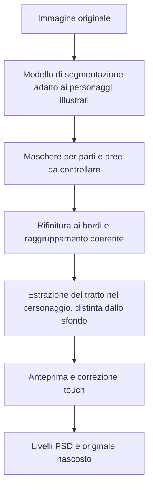

# Proposta: parti del personaggio e tratto separato

**Stato: proposta da approvare.** Questa PR contiene il progetto della modifica; l’app pubblicata resta alla versione attuale.

## Risultato cercato

Da un ritratto illustrato ottenere livelli che abbiano senso per chi disegna in Fresco. Sull’esempio fornito, l’ordine proposto dall’alto verso il basso è:

| Livello           | Contenuto atteso                                                                           |
| ----------------- | ------------------------------------------------------------------------------------------ |
| Tratto / contorni | Linee di penna di capelli, occhi, naso, bocca, viso e abiti; esclude il nero dello sfondo. |
| Accessori         | Orecchini e altri oggetti riconosciuti.                                                    |
| Occhi             | Le parti degli occhi, senza disperderle in gruppi cromatici.                               |
| Bocca             | Labbra e interno della bocca riconosciuti.                                                 |
| Capelli           | Capelli e ciocche, compresa la parte laterale lunga del personaggio.                       |
| Pelle             | Viso, orecchie e collo, come richiesto.                                                    |
| Vestiti           | Le regioni dell’abito mantenute in un gruppo coerente.                                     |
| Sfondo            | Il fondo nero nell’esempio, separato dai contorni.                                         |
| Originale         | Copia intatta, nascosta, per confronto e recupero.                                         |

Il numero dei livelli dipende dalle parti presenti e riconosciute. Non creare livelli vuoti per simulare un riconoscimento riuscito. Il tratto sarà raster: da un JPG piatto non si recuperano le pennellate originali né i loro tracciati vettoriali.

## Perché il metodo attuale frammenta l’immagine

La modalità per colore raggruppa pixel simili: una tinta scura può comparire nei capelli, nella pelle, nei vestiti e nello sfondo. Anche il livello attuale “Lineart” deriva dalla luminosità; per questo può inglobare una grande area di fondo nero.

Aumentare i colori o rinominare quei gruppi non risolve il problema. Serve riconoscere le parti del personaggio e poi assegnare i pixel a quelle parti.

## Flusso proposto su iPad

1. **Separa personaggio.** Nuova modalità dedicata ai ritratti illustrati. Le modalità per sticker e colori restano disponibili per le immagini adatte.
2. **Controlla le parti.** Anteprima grande dell’immagine con maschere colorate, nomi comprensibili e visualizzazione del singolo livello su trasparenza. Mostrare separatamente le parti non riconosciute o da verificare.
3. **Controlla il tratto.** Interruttore “Separa tratto” e regolazione della sensibilità, con confronto immediato. Una campitura scura o lo sfondo non devono diventare automaticamente tratto.
4. **Correggi con il tocco.** Seleziona una parte e aggiungi/togli una zona con pennello o selezione assistita. Possibilità di unire gruppi e assegnare una zona ad “Accessori” quando il riconoscimento la sbaglia. Annulla/ripristina anche durante la correzione.
5. **Usa i livelli.** Applica solo dopo il controllo, conserva l’originale nascosto ed esporta il PSD con nomi e ordine coerenti.

Una maschera incerta deve essere correggibile prima di creare il PSD. Non basta rendere più bella la griglia delle miniature.

## Come lo costruirei

**Prima il modello, poi l’integrazione.** Realizzare un prototipo sulla stessa immagine della segnalazione e verificare il risultato visivamente. Se il modello scambia capelli e pelle, perde la bocca o ingloba i vestiti nei capelli, non integrarlo come soluzione pronta.

**Selezione semantica.** Usare un modello addestrato sulle parti di personaggi illustrati. Riunire le sue classi nel piccolo insieme di livelli concordato. Raffinare le maschere sui bordi dell’immagine e ricondurre i piccoli frammenti alla parte vicina appropriata, evitando di rimuovere dettagli validi come gli orecchini.

**Tratto.** Estrarlo dopo aver distinto personaggio e sfondo. Valutare contrasto locale, forma dei segni e bordi: una soglia globale sul nero includerebbe lo sfondo e le ombre. Il tratto può essere marrone o colorato. Lasciare controllo della sensibilità e correzione manuale quando un’ombra assomiglia a una linea. L’estrazione di linee da un’immagine già composta è una stima, da validare sull’anteprima.

**Conservazione dell’immagine.** Nella prima versione proposta i pixel originali vengono ripartiti tra le maschere, senza inventare parti nascoste. La ricomposizione di tutti i livelli visibili deve restituire l’immagine iniziale, con test di confronto. Una maschera sbagliata deve poter essere corretta senza cancellare dati. Separare il tratto non ricrea automaticamente il colore che era coperto dalla penna: un’eventuale ricostruzione di quelle piccole zone richiede una fase successiva, distinta e verificabile.

**Dove gira l’AI.** Preferire l’elaborazione sul dispositivo se raggiunge qualità e prestazioni accettabili su iPad. I modelli leggeri provati finora non raggiungono la qualità necessaria sull’esempio. Per una versione più capace, la strada da valutare è un backend dedicato al modello per anime, mantenendo anteprima, correzioni ed esportazione sul dispositivo. Questo cambierebbe la privacy rispetto all’app attuale: l’immagine verrebbe inviata al servizio di analisi. Hosting, eventuale GPU, tempi, costo e gestione dei file devono essere definiti nella scelta tecnica; questa PR non attiva servizi o chiavi API.

## Verifica preliminare già eseguita

Sono state eseguite prove locali esplorative sulla foto allegata, in uno spazio di lavoro temporaneo, senza cambiare il codice dell’app e senza inserire la foto nel repository pubblico.

| Candidato                            | Cosa è emerso sull’esempio                                                                                | Decisione                       |
| ------------------------------------ | --------------------------------------------------------------------------------------------------------- | ------------------------------- |
| BiSeNet ResNet18 per face parsing    | Alcune macro regioni plausibili, ma capelli classificati in parte come cappello e bocca non riconosciuta. | Non pronto per questa funzione. |
| SegFormer face parsing quantizzato   | Diversi errori tra capelli, cappello e pelle; bocca e accessori insufficienti.                            | Non pronto per questa funzione. |
| UNet/MobileNetV2 addestrato su anime | Leggero, ma sul personaggio dell’esempio confonde ampie zone di capelli, pelle e abito.                   | Non pronto per questa funzione. |

Sono risultati su **una singola immagine**, non un confronto generale fra i modelli. Le prove servono a evitare di promettere una separazione corretta solo perché il modello produce etichette anatomiche. Nessuno dei tre è stato integrato o pubblicato.

Riferimenti dei candidati verificati: [yakhyo/face-parsing](https://github.com/yakhyo/face-parsing), [Xenova/face-parsing](https://huggingface.co/Xenova/face-parsing), [siyeong0/Anime-Face-Segmentation](https://github.com/siyeong0/Anime-Face-Segmentation). Per il prossimo prototipo valutare un parser specifico per le parti degli anime, anche fra gli approcci di [See-through](https://github.com/shitagaki-lab/see-through), verificando prima pesi, licenze, requisiti e qualità effettiva. Non è ancora stato selezionato un modello definitivo.

## Quando il prototipo è abbastanza buono

Sulla stessa immagine usata per la segnalazione:

- Capelli, pelle, occhi, bocca e vestiti sono regioni riconoscibili e coerenti, non una raccolta di pixel dello stesso colore.
- Gli orecchini sono riconosciuti o assegnabili con una correzione semplice; non spariscono nel filtro dei frammenti piccoli.
- Il livello del tratto mostra i segni di penna e non il rettangolo nero dello sfondo.
- La ricomposizione conserva i pixel dell’originale; il test rileva perdite, duplicazioni o cambi di colore.
- Si può isolare una parte, correggerla e annullare la correzione con dita o Pencil.
- L’anteprima distingue le parti riuscite da quelle da controllare, senza dichiarare una precisione non misurata.
- Il flusso resta praticabile in Safari su iPad; prima di pubblicare, misurare memoria e tempi sul dispositivo reale e verificare il PSD in Fresco.

Dopo il primo caso, provare anche un secondo personaggio con colori diversi, una posa diversa e uno sfondo diverso, per evitare una soluzione cucita su questa sola immagine.

## Passi dopo l’approvazione

1. Prototipo della separazione semantica e del tratto, con confronto visivo sulla foto fornita e su un secondo caso.
2. Scelta del modello e dell’esecuzione locale o su backend in base ai risultati misurati.
3. Integrazione di anteprima, correzione touch e PSD; test su maschere, ricomposizione e cronologia.
4. Prova su iPad e pubblicazione della versione verificata.

L’approvazione di questa proposta avvia il prototipo. La qualità della segmentazione sulla foto fornita è il primo criterio di avanzamento.
